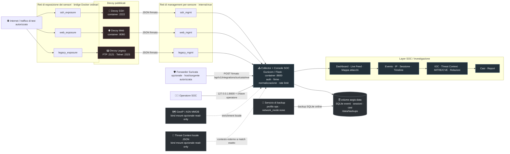

<p align="center">
  
</p>

<p align="center"><a href="README.md">🇬🇧 English</a> · <a href="README.it.md">🇮🇹 Italiano</a></p>

<p align="center">
  
  
  
  
  
  
</p>

> Una piattaforma bilingue honeypot e di analisi SOC "evidence-first" per monitoraggio degli attacchi, investigazione, threat research e apprendimento della cybersecurity.

<p align="center"><a href="SECURITY.md">Sicurezza</a> · <a href="docs/THREAT_MODEL.md">Modello di minaccia</a> · <a href="docs/DATA_PROVENANCE.md">Provenienza dei dati</a> · <a href="docs/NETWORK_EVIDENCE.md">Evidenza di rete</a> · <a href="docs/PRIVACY.md">Privacy e retention</a> · <a href="docs/INVESTIGATION.md">Investigazione</a> · <a href="docs/OPERATIONS.md">Operations</a> · <a href="docs/ROADMAP.md">Roadmap</a> · <a href="LICENSE">Licenza</a></p>

> [!IMPORTANT]
> Esponi i sensori honeypot solo su infrastruttura di tua proprietà o che sei esplicitamente autorizzato a monitorare. L’avvio rapido associa le porte pubblicate all’interfaccia di loopback del tuo computer. Prima di esporre qualcosa su Internet, leggi la documentazione su sicurezza, privacy e isolamento.

---

## 🌱 Sei alle prime armi? Leggi prima questo

**Cos'è un honeypot?** Un honeypot è un servizio finto e volutamente debole (un finto login SSH, un finto sito web, …) il cui unico scopo è *farsi attaccare*. Nessun utente reale dovrebbe mai usarlo, quindi **ogni connessione che riceve è sospetta** — ed è proprio questo a renderlo una fonte pulita di dati sugli attacchi.

**Cosa fa AEGIS-NEXUS?** Avvia diversi di questi servizi finti (i "decoy"), registra in sicurezza ciò che gli attaccanti provano — gli username e le password che indovinano, i comandi che digitano, le richieste che inviano — e ti offre una dashboard web (una mini "console SOC") per esplorare e investigare quell'attività. Fondamentale: **non esegue mai i comandi dell'attaccante**; li registra soltanto.

**A chi serve?**
- 🎓 Chi **studia** cybersecurity e vuole dati d'attacco realistici su cui esercitarsi.
- 🛡️ **Blue team / analisti SOC** che vogliono un piccolo laboratorio autonomo per monitorare e investigare.
- 🔬 **Ricercatori** che studiano il comportamento degli attaccanti.

**Cosa espone la configurazione locale?** Per impostazione predefinita le porte pubblicate sono associate al loopback, i container operano con privilegi ridotti e i decoy emulano le interazioni senza eseguire i comandi raccolti. Tratta i dati acquisiti come sensibili e custodisci la chiave operatore.

👉 **Vuoi solo provarlo?** Vai all'[avvio rapido in 5 minuti](#-avvio-rapido-in-5-minuti). Nuovo con i termini? Vedi [Parole in parole semplici](#-parole-in-parole-semplici).

## ⏱️ Avvio rapido (in 5 minuti)

Esegue tutto **in locale sul tuo computer**. Ti serve solo [Docker](https://docs.docker.com/get-docker/) installato e in esecuzione.

```bash
# 1. Scarica il codice
git clone https://github.com/chiaraberti13/AEGIS-NEXUS.git
cd AEGIS-NEXUS

# 2. Crea il file delle impostazioni
cp .env.example .env

# 3. Genera 4 chiavi segrete casuali (esegui 4 volte) e incollale in .env
python -c "import secrets; print(secrets.token_urlsafe(48))"

# 4. Avvia tutto
docker compose up -d --build

# 5. Verifica che sia sano (dovrebbe stampare {"status":"ok"})
curl -fsS http://127.0.0.1:8600/health
```

Al passo 3, metti un valore generato diverso su ciascuna di queste righe in `.env`:

```text
AEGIS_SSH_SENSOR_API_KEY=<segreto-casuale-1>
AEGIS_WEB_SENSOR_API_KEY=<segreto-casuale-2>
AEGIS_LEGACY_SENSOR_API_KEY=<segreto-casuale-3>
AEGIS_OPERATOR_API_KEY=<segreto-casuale-4>
```

Ora apri **http://127.0.0.1:8600** nel browser e, quando richiesto, incolla il tuo `AEGIS_OPERATOR_API_KEY`. Quella è la console SOC. 🎉

Vuoi vedere apparire dei dati? Genera un po' di traffico di test locale e sicuro (vedi [Provalo](#-provalo)), poi guardalo comparire nel **Live Feed**. Quando hai finito:

```bash
docker compose down        # ferma tutto (conserva i tuoi dati)
```

> Bloccato? Vedi [Problemi comuni](#-problemi-comuni-troubleshooting).

## 🧩 Parole in parole semplici

| Termine | Cosa significa qui |
|---|---|
| **Decoy / sensore honeypot** | Un servizio finto (SSH, web, FTP, Telnet) che esiste solo per essere attaccato e registrare il tentativo. |
| **Collector** | Il servizio centrale che riceve ciò che i decoy registrano, lo controlla e lo memorizza. |
| **Console SOC** | La dashboard web che apri nel browser per osservare e investigare l'attività. ("SOC" = Security Operations Centre.) |
| **Telemetria** | I dati che i decoy catturano su una connessione (chi si è connesso, cosa ha provato). |
| **Evento** | Una singola cosa registrata — un tentativo di login, un comando, una richiesta web. |
| **Sessione** | Un gruppo di eventi correlati dallo stesso visitatore, ricuciti insieme. |
| **Provenienza** | *Da dove proviene un'informazione.* AEGIS tiene sempre separato "ciò che è stato osservato" da "ciò che abbiamo ipotizzato". |
| **Enrichment** | Contesto aggiuntivo aggiunto in seguito, es. il Paese/rete a cui appartiene un IP. È contesto, **non** la prova di chi sia stato. |
| **IOC** | "Indicatore di compromissione" — un artefatto riutilizzabile come un URL, un dominio o l'hash di un file visto nell'attacco. |
| **Suricata** | Un diffuso strumento di rilevamento intrusioni di rete da cui AEGIS può opzionalmente leggere dati. |

## 📖 Cos'è AEGIS-NEXUS (la versione lunga)

AEGIS-NEXUS è un **Honeypot + analisi SOC + threat research + laboratorio di apprendimento della cybersecurity**. Espone decoy SSH, web, FTP e Telnet volutamente limitati, raccoglie telemetria ostile tramite canali sensore autenticati e la trasforma in un flusso di investigazione senza mai eseguire comandi o payload forniti dall'attaccante.

La regola di design centrale è la provenienza: **dati osservati, enrichment esterno, analisi derivata e ipotesi restano separati**, mentre i metadati di normalizzazione controllati dal collector dichiarano esplicitamente troncamenti, redazioni e altre trasformazioni. GeoIP, ASN, match di threat-context locale, estrazione IOC, mapping MITRE ATT&CK e riferimenti CVE non sono mai presentati come fatti a meno che l'evidenza memorizzata non li sostenga.

## ✨ Capacità principali

- Decoy SSH, web, FTP e Telnet isolati con segreti per-sensore, telemetria firmata e nonce di richiesta monouso.
- Collector Flask/Gunicorn con ingestione JSON bounded, rate limit, validazione dell'input ostile e persistenza SQLite. È disponibile un adattatore PostgreSQL autonomo per integrazioni di storage e test del contratto. Vedi la [documentazione dello storage](docs/STORAGE.md).
- Correlazione di sessione tramite ID di connessione espliciti del decoy o identità di flow Suricata quando disponibile, con fallback temporale.
- Dashboard SOC con ricerca e filtri globali, Live Feed, attacchi nel tempo, IP unici, Paesi, ASN, porte, protocolli, servizi, honeypot, credenziali, comandi, payload, alert IDS, IOC, MITRE/CVE e heatmap temporali.
- Mappa degli attacchi interattiva basata solo sull'enrichment di geolocalizzazione memorizzato.
- Flusso di investigazione evento → IP → sessione → timeline → evidenza → enrichment → relazioni → caso → report.
- Gestione dei casi SOC che preserva l'evidenza, con note analista, tag, audit trail e report JSON/CSV/Markdown.
- Enrichment GeoIP/ASN offline da file MaxMind MMDB forniti dall'operatore.
- Threat context offline a corrispondenza esatta da un feed JSON fornito dall'operatore; gli indicatori catturati non vengono mai inviati a servizi di terze parti.
- Estrazione deterministica di IOC/artefatti da comandi e payload osservati, senza etichettare automaticamente i valori come malevoli.
- Ingestione nativa di Suricata EVE JSON (inclusi i valori di fingerprint JA3/JA3S/JA4 e JA4H, conservati come evidenza osservata).
- Fingerprint HASSH del client SSH e offer-list KEXINIT catturati come indizi operativi osservati e bounded — mai come identità.
- Evidenza di rete versionata con provenienza socket/HTTP/Suricata, durata/contatori di flow, metadati HTTP bounded, evidenza TLS/DNS e un pannello di investigazione.
- Evidenza PCAP opzionale bounded e solo-operatore, più un pattern opt-in di sidecar di cattura pacchetti dedicato (vedi [`docs/PCAP_CAPTURE.md`](docs/PCAP_CAPTURE.md)); i privilegi di cattura elevati restano disabilitati per default.
- Interfaccia bilingue IT/EN tramite dizionari i18n centrali.
- Container hardened: runtime non-root, filesystem read-only, capability droppate, `no-new-privileges`, limiti di risorse e reti di management separate.
- Binding CIDR di management per-sensore: le identità dei decoy integrati sono accettate solo dalla subnet interna attesa, mentre le zone di fiducia dei sensori non possono raggiungere le API operatore/UI.
- Egress guard lato host Linux (`DOCKER-USER`) che blocca nuove connessioni iniziate dai decoy preservando il traffico di risposta per le porte honeypot pubblicate.
- Evidence Integrity con metadati collector separati, indicatori di troncamento/redazione e fingerprint delle credenziali calcolati dal valore originale prima dei limiti di storage.
- Retention per tempo/capacità, backup SQLite online, readiness check e paginazione storica bounded.

## 🗺️ Diagramma dell'architettura

> Alla prima lettura puoi tranquillamente saltare questa immagine — mostra come i pezzi si collegano una volta avviato tutto.



Il diagramma riflette la topologia Compose predefinita. I tre decoy **non** condividono una rete di management laterale: ogni sensore ha la propria rete di esposizione e la propria rete di management `internal: true` collegata al collector. Le reti di esposizione sono normali bridge Docker, quindi **non sono un confine di controllo egress**; i deployment esposti su Internet devono limitare il traffico in uscita con il firewall host/VLAN.

La console SOC è pubblicata solo su `127.0.0.1:8600` per default. Le porte dei sensori sono pubblicate sull'host senza binding su loopback, quindi la loro raggiungibilità reale da Internet dipende dall'host Docker, dal firewall e dalla policy NAT. Il forwarder Suricata opzionale punta all'endpoint di ingestione del collector; l'inoltro remoto dovrebbe passare per un percorso autorizzato protetto da TLS, non esporre direttamente la console operatore.

Il servizio di backup condivide solo il volume persistente `aegis-data` e gira con `network_mode: none`.

**Flusso dei dati:** `traffico attaccante/test → rete di esposizione → decoy → evento normalizzato firmato → rete di management interna → collector → validazione/correlazione/enrichment → SQLite → dashboard/investigazione/casi/report`.

## 🧭 Modello di investigazione

AEGIS tiene distinte quattro classi di provenienza — è il cuore del progetto:

1. **Observed (osservato)** — fatti catturati direttamente da un decoy o IDS.
2. **Enrichment** — contesto esterno/locale con provenienza di sorgente e timestamp.
3. **Derived (derivato)** — artefatti, IOC, analisi MITRE o CVE sostenuti da evidenza.
4. **Hypotheses (ipotesi)** — interpretazione dell'analista, che deve restare visibilmente separata dai fatti.

Il flusso tipico dell'analista è:

`Dashboard → evento → IP → sessione → timeline → credenziali/comandi/payload → Threat Intelligence/enrichment → MITRE/CVE/IOC → relazioni → caso → report`

Vedi il [Flusso di investigazione](docs/INVESTIGATION.md) per il modello di evidenza completo.

## 🚀 Installazione completa (passo passo)

L'[avvio rapido](#-avvio-rapido-in-5-minuti) qui sopra basta per provare AEGIS. Questa sezione spiega ogni passo con un po' più di dettaglio.

### 1. Prerequisiti

Ti serve, sul tuo computer:

- **Docker Engine / Docker Desktop**, in esecuzione.
- **Docker Compose v2** — verifica con `docker compose version` (nota lo spazio; deve stampare una versione).
- **Git** per scaricare il codice.
- Le porte host `2222`, `8080`, `2121`, `2323` e la porta locale `8600` libere (se una è occupata, vedi [Problemi comuni](#-problemi-comuni-troubleshooting)).
- Per gli esempi da riga di comando: `curl`, un client SSH e `nc`/netcat.

Python 3.12+ serve solo per lo sviluppo locale o gli script helper lato host (come il forwarder Suricata), non per il normale deployment Docker.

### 2. Clona il repository

```bash
git clone https://github.com/chiaraberti13/AEGIS-NEXUS.git
cd AEGIS-NEXUS
```

### 3. Crea il file di ambiente

```bash
cp .env.example .env
```

`.env` è il tuo file privato di impostazioni (non viene mai committato). Genera un valore ad alta entropia diverso per **ogni** sensore e per l'account operatore:

```bash
python -c "import secrets; print(secrets.token_urlsafe(48))"
```

Eseguilo quattro volte e metti valori diversi in `.env`:

```text
AEGIS_SSH_SENSOR_API_KEY=<segreto-casuale-1>
AEGIS_WEB_SENSOR_API_KEY=<segreto-casuale-2>
AEGIS_LEGACY_SENSOR_API_KEY=<segreto-casuale-3>
AEGIS_OPERATOR_API_KEY=<segreto-casuale-4>
```

Queste chiavi sono il modo in cui i decoy provano la propria identità al collector, e il modo in cui *tu* accedi alla console. Lascia vuoto `AEGIS_INGEST_API_KEY` quando usi l'allowlist per-sensore predefinita. Imposta `AEGIS_SURICATA_SENSOR_API_KEY` solo se ingerisci telemetria Suricata. Non committare `.env`.

### 4. Builda e avvia AEGIS-NEXUS

```bash
docker compose up -d --build
```

Controlla lo stato dei container:

```bash
docker compose ps
```

Controlla la readiness del collector:

```bash
curl -fsS http://127.0.0.1:8600/health
```

Un collector sano risponde:

```json
{"status":"ok"}
```

### 5. Apri la console SOC

Apri **http://127.0.0.1:8600** e, quando richiesto, inserisci il valore di `AEGIS_OPERATOR_API_KEY` dal tuo `.env`. Il browser lo conserva solo in `sessionStorage`; chiudere la sessione o usare il pulsante di lock lo rimuove. L'identità operatore autenticata è mostrata nell'header della console. Per deployment multi-analista puoi emettere chiavi per-analista con `AEGIS_OPERATOR_KEYS` accanto alla singola chiave di laboratorio — vedi [`docs/OPERATIONS.md`](docs/OPERATIONS.md). Modifiche al ciclo di vita degli alert, modifiche ai casi, export e accessi a PCAP/artefatti sono registrati in un log di audit operatore append-only — vedi [`docs/AUDIT_LOG.md`](docs/AUDIT_LOG.md).

## 🔌 Porte predefinite

| Componente | Endpoint host | Scopo |
|---|---:|---|
| Decoy SSH | `host:2222` | Interazione SSH emulata e telemetria dei comandi |
| Decoy Web | `http://host:8080` | Telemetria di login, richieste e payload |
| Decoy FTP | `host:2121` | Telemetria legacy delle credenziali |
| Decoy Telnet | `host:2323` | Telemetria legacy delle credenziali |
| Console SOC | `http://127.0.0.1:8600` | Dashboard e API solo-operatore |

Le porte dei sensori si cambiano con le variabili `AEGIS_PUBLIC_*_PORT`. A differenza della console, i sensori non sono vincolati a loopback per default: limita l'esposizione con policy di firewall/NAT. Mantieni privata la console operatore; per l'accesso remoto usa TLS e controlli perimetrali come l'esempio in `deploy/nginx.conf.example`.

## 🎮 Provalo

### Genera telemetria di test locale e sicura

Usa solo credenziali e dati di test. **Non digitare mai password reali in un honeypot.**

SSH:

```bash
ssh -p 2222 demo@127.0.0.1
# nella shell emulata prova: pwd, ls, uname -a
```

Web:

```bash
curl http://127.0.0.1:8080/
curl -X POST http://127.0.0.1:8080/login -d "username=demo&password=demo"
curl "http://127.0.0.1:8080/internal-db?q=status"
```

FTP/Telnet con `nc`:

```bash
printf "USER demo\r\nPASS demo\r\nQUIT\r\n" | nc 127.0.0.1 2121
printf "demo\r\ndemo\r\n" | nc 127.0.0.1 2323
```

Gli eventi risultanti compaiono nel Live Feed e diventano disponibili per ricerca, correlazione di sessione, grafo delle relazioni, casi e report.

### Investiga un evento

1. Apri la **Dashboard** e usa la finestra temporale, la barra di ricerca o i grafici analitici per restringere il dataset.
2. Seleziona un elemento nel **Live Feed** o sulla **Mappa attacchi**.
3. Ispeziona i quattro blocchi di provenienza: Observed, Enrichment, Derived e Hypotheses.
4. Apri il **profilo IP** sorgente e la **sessione** correlata.
5. Esamina timeline, credenziali, comandi, payload, alert IDS, IOC, contesto di Threat Intelligence e mapping MITRE/CVE sostenuti da evidenza.
6. Apri **Relazioni** per ispezionare i collegamenti tra eventi, sessioni, IP, porte, ASN, credenziali, payload, IOC e mapping.
7. Crea o aggiorna un **Caso**, allega evidenza di evento/sessione e aggiungi note analista.
8. Esporta report JSON/CSV/Markdown/PDF (con profili di redazione interni/condivisibili).

### Investigazione storica

Il Live Feed mostra la telemetria recente. Nella vista di Investigazione usa **Carica eventi più vecchi** per aggiungere eventi precedenti corrispondenti senza perdere l'ambito di ricerca/filtro corrente. La paginazione usa cursori opachi stabili invece di offset.

## 🆘 Problemi comuni (troubleshooting)

| Sintomo | Causa probabile e soluzione |
|---|---|
| `docker compose version` fallisce o "command not found" | Docker Compose v2 non è installato/aggiornato. Installa Docker Desktop, o il pacchetto `docker-compose-v2` su Linux. |
| `Cannot connect to the Docker daemon` | Docker non è in esecuzione. Avvia Docker Desktop, o su Linux `sudo systemctl start docker`. |
| `curl http://127.0.0.1:8600/health` non risponde | I container potrebbero essere ancora in build/avvio — attendi qualche secondo e riprova, o controlla `docker compose logs collector`. |
| `port is already allocated` / `address already in use` | Un altro programma usa quella porta. Fermalo, o cambia le porte dei decoy con `AEGIS_PUBLIC_*_PORT` in `.env`. |
| La console chiede una chiave e la rifiuta | Hai incollato il valore sbagliato — deve essere uguale a `AEGIS_OPERATOR_API_KEY` nel tuo `.env` (non una chiave sensore). |
| All'avvio esce un errore su `AEGIS_SSH_SENSOR_API_KEY` | Una chiave richiesta in `.env` è vuota. Compila tutte e quattro le chiavi del passo 3. |
| Nessun dato nel Live Feed | Genera un po' di traffico di test (vedi [Provalo](#-provalo)); gli eventi compaiono in uno o due secondi. |
| Permesso negato nell'eseguire `docker` su Linux | Aggiungi il tuo utente al gruppo `docker` (`sudo usermod -aG docker "$USER"`) poi esci e rientra. |

Ancora bloccato? Apri i log del collector con `docker compose logs -f collector`, oppure [segnala un problema](https://github.com/chiaraberti13/AEGIS-NEXUS/issues/new/choose).

## 🌍 Opzionale: enrichment GeoIP / ASN locale

AEGIS può usare file MaxMind GeoIP2/GeoLite2 MMDB forniti dall'operatore senza inviare gli IP catturati a un'API esterna.

```bash
mkdir -p geoip
# metti GeoLite2-City.mmdb e GeoLite2-ASN.mmdb in ./geoip
docker compose -f docker-compose.yml -f docker-compose.geoip.yml up -d --build
```

Vedi [Enrichment locale](docs/ENRICHMENT.md).

## 🔎 Opzionale: threat context locale

AEGIS può fare match esatto di IP osservati e artefatti URL/dominio/hash derivati contro un feed JSON locale. I match restano contesto esterno e non cambiano automaticamente la severità, non creano CVE/mapping MITRE e non attribuiscono un actor.

```bash
mkdir -p threat-context
# metti feed.json in ./threat-context
docker compose -f docker-compose.yml -f docker-compose.threat-context.yml up -d --build
```

Vedi [Threat context locale](docs/THREAT_CONTEXT.md) per lo schema del feed.

Entrambi gli overlay opzionali possono essere abilitati insieme:

```bash
docker compose \
  -f docker-compose.yml \
  -f docker-compose.geoip.yml \
  -f docker-compose.threat-context.yml \
  up -d --build
```

## 🛡️ Opzionale: ingestione Suricata

Imposta un `AEGIS_SURICATA_SENSOR_API_KEY` indipendente in `.env`. L'helper incluso è un'utility Python lato host: installa prima il pacchetto (`python -m pip install -e .`), poi inoltra i record EVE JSON:

```bash
export AEGIS_SURICATA_SENSOR_API_KEY="<segreto-suricata-configurato-in-.env>"
python scripts/send_suricata_event.py --file /var/log/suricata/eve.json --sensor suricata-01
```

Gli alert Suricata sono memorizzati come telemetria IDS osservata. AEGIS non inventa mapping MITRE o CVE dalla sola firma. I *valori* di fingerprint TLS (JA3/JA3S/JA4) e HTTP (JA4H) calcolati da Suricata/Zeek sono conservati come evidenza osservata — AEGIS non calcola mai quei fingerprint proprietari (vedi [`docs/NETWORK_EVIDENCE.md`](docs/NETWORK_EVIDENCE.md)).

## ⚙️ Operations

Vedi i log del collector:

```bash
docker compose logs -f collector
```

Riavvia il collector:

```bash
docker compose restart collector
```

Crea un backup SQLite online:

```bash
docker compose --profile ops run --rm backup
```

Ferma lo stack senza eliminare il volume del database:

```bash
docker compose down
```

Elimina i container **e tutti i dati persistenti di AEGIS**:

```bash
docker compose down -v
```

> ⚠️ `docker compose down -v` rimuove definitivamente il volume `aegis-data`. Esporta o fai un backup di ciò che ti serve prima.

Per dettagli operativi, readiness, retention, chiavi e indicazioni TLS vedi [Operations](docs/OPERATIONS.md).

## 🧪 Sviluppo locale

```bash
python -m pip install -e ".[dev]"
pytest -q
AEGIS_DATABASE_PATH=./data/aegis.db \
AEGIS_OPERATOR_API_KEY="sostituisci-con-un-segreto-lungo-e-casuale" \
flask --app aegis_nexus.app run --host 127.0.0.1 --port 8600
```

Il deployment Docker completo è consigliato quando testi i decoy, perché applica la separazione di rete e l'hardening dei container definiti dal progetto.

## 📦 Struttura del repository

```text
AEGIS-NEXUS/
├── docker-compose.yml                  stack hardened predefinito
├── docker-compose.geoip.yml            mount GeoIP/ASN locale opzionale
├── docker-compose.threat-context.yml   mount feed threat locale opzionale
├── docker-compose.pcap.yml             sidecar di cattura PCAP dedicati opzionali
├── deploy/                             esempio di reverse proxy
├── docs/                               doc di sicurezza, privacy, operations e investigazione
├── scripts/                            backup, forwarding Suricata e utility
├── src/aegis_nexus/
│   ├── app.py                          API del collector e console SOC
│   ├── store.py                        persistenza SQLite, analytics e casi
│   ├── model.py                        normalizzazione dell'input ostile
│   ├── correlation.py                  correlazione di sessione
│   ├── derivation.py                   estrazione deterministica di artefatti
│   ├── enrichment.py                   GeoIP/ASN locale
│   ├── threat_context.py               threat context locale a match esatto
│   ├── reporting.py                    report di investigazione sicuri
│   ├── sensors/                        decoy SSH, web, FTP/Telnet
│   ├── static/                         JS della dashboard, i18n e CSS
│   └── templates/                      template della console SOC
└── tests/                              test di regressione e di sicurezza
```

## 🔒 Sicurezza, privacy e attribuzione

La telemetria honeypot può contenere indirizzi IP, credenziali e payload controllati dall'attaccante. Definisci una finalità lecita e un periodo di retention, proteggi l'accesso operatore e non pubblicare dati personali o segreti catturati.

GeoIP, ASN e match di threat-context descrivono infrastruttura o contesto esterno. VPN, proxy, gateway NAT, provider di hosting e sistemi compromessi possono mascherare l'origine reale. AEGIS-NEXUS non identifica automaticamente una persona, un threat actor, una famiglia di malware o una campagna.

I deployment esposti su Internet dovrebbero usare una VM/VLAN dedicata, negare le rotte verso le reti di produzione, limitare l'egress dei sensori sul firewall host/di rete e usare TLS per l'accesso remoto dell'operatore.

Leggi [Sicurezza](SECURITY.md), [Modello di minaccia](docs/THREAT_MODEL.md), [Privacy e retention](docs/PRIVACY.md) e [Isolamento dei sensori](docs/SENSOR_ISOLATION.md) prima di esporre i decoy su Internet.

## 📄 Licenza e uso responsabile

Rilasciato sotto la [licenza GNU GPL-3.0](LICENSE). Usa AEGIS-NEXUS solo su infrastruttura di tua proprietà o che sei esplicitamente autorizzato a monitorare. Non usarlo per contrattaccare, accedere a sistemi di terzi o pubblicare credenziali/dati personali catturati.

---

<p align="center">
  <sub>Realizzato con 🛡️ da <a href="https://github.com/chiaraberti13">chiaraberti13</a> · © 2026 Chiara Berti</sub>
</p>

---

## Community e collaborazione

- [Linee guida per contribuire](CONTRIBUTING.md)
- [Codice di condotta](CODE_OF_CONDUCT.md)
- [Segnalazioni di sicurezza](SECURITY.md)
- [Accessibilità e limiti di verifica](ACCESSIBILITY.md)
- [Segnala un problema o proponi un miglioramento](https://github.com/chiaraberti13/AEGIS-NEXUS/issues/new/choose)
- [Licenza del progetto](LICENSE)
