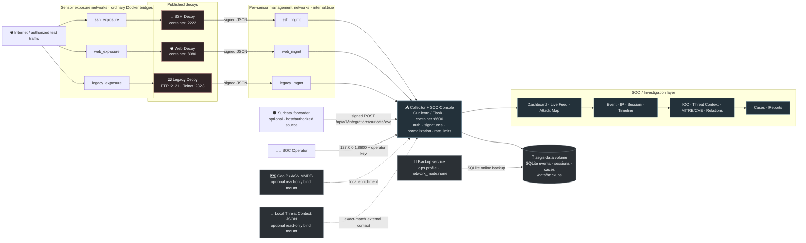

<p align="center">
  
</p>

<p align="center"><a href="README.md">🇬🇧 English</a> · <a href="README.it.md">🇮🇹 Italiano</a></p>

<p align="center">
  
  
  
  
  
  
</p>

> An evidence-first bilingual honeypot and SOC analysis platform for attack monitoring, investigation, threat research and cybersecurity learning.

<p align="center"><a href="SECURITY.md">Security</a> · <a href="docs/THREAT_MODEL.md">Threat model</a> · <a href="docs/DATA_PROVENANCE.md">Data provenance</a> · <a href="docs/NETWORK_EVIDENCE.md">Network evidence</a> · <a href="docs/PRIVACY.md">Privacy &amp; retention</a> · <a href="docs/INVESTIGATION.md">Investigation</a> · <a href="docs/OPERATIONS.md">Operations</a> · <a href="docs/ROADMAP.md">Roadmap</a> · <a href="LICENSE">Licence</a></p>

> [!IMPORTANT]
> Deploy honeypot sensors only on infrastructure you own or are explicitly authorized to monitor. The quick start binds the published ports to your computer’s loopback interface. Before exposing anything to the Internet, read the security, privacy and isolation documentation.

---

## 🌱 New here? Read this first

**What is a honeypot?** A honeypot is a fake, deliberately weak service (a fake SSH login, a fake website, …) whose only job is to *get attacked*. Nobody real should ever use it, so **every connection it receives is suspicious** — and that is exactly what makes it a clean source of attack data.

**What does AEGIS-NEXUS do?** It runs several of these fake services ("decoys"), safely records what attackers try — the usernames and passwords they guess, the commands they type, the requests they send — and gives you a web dashboard (a mini "SOC console") to explore and investigate that activity. Crucially, it **never runs the attacker's commands**; it only records them.

**Who is it for?**
- 🎓 People **learning** cybersecurity who want real-looking attack data to practice on.
- 🛡️ **Blue teams / SOC analysts** who want a small, self-contained lab to monitor and investigate.
- 🔬 **Researchers** studying attacker behaviour.

**What does the local setup expose?** The published ports are bound to loopback by default, the containers run with restricted privileges, and the decoys emulate interactions without running captured commands. Treat captured data as sensitive and keep the operator key private.

👉 **Just want to try it?** Jump to the [5-minute quick start](#-quick-start-in-5-minutes). New to the vocabulary? See [Words in plain English](#-words-in-plain-english).

## ⏱️ Quick start (in 5 minutes)

This runs everything **locally on your computer**. You only need [Docker](https://docs.docker.com/get-docker/) installed and running.

```bash
# 1. Get the code
git clone https://github.com/chiaraberti13/AEGIS-NEXUS.git
cd AEGIS-NEXUS

# 2. Create your settings file
cp .env.example .env

# 3. Generate 4 random secret keys (run this 4 times) and paste them into .env
python -c "import secrets; print(secrets.token_urlsafe(48))"

# 4. Start everything
docker compose up -d --build

# 5. Check it's healthy (should print {"status":"ok"})
curl -fsS http://127.0.0.1:8600/health
```

In step 3, put a different generated value on each of these lines in `.env`:

```text
AEGIS_SSH_SENSOR_API_KEY=<random-secret-1>
AEGIS_WEB_SENSOR_API_KEY=<random-secret-2>
AEGIS_LEGACY_SENSOR_API_KEY=<random-secret-3>
AEGIS_OPERATOR_API_KEY=<random-secret-4>
```

Now open **http://127.0.0.1:8600** in your browser and, when asked, paste your `AEGIS_OPERATOR_API_KEY`. That's the SOC console. 🎉

Want to see data appear? Generate some safe, local test traffic (see [Try it out](#-try-it-out)), then watch it show up in the **Live Feed**. When you're done:

```bash
docker compose down        # stop (keeps your data)
```

> Stuck? See [Common problems](#-common-problems-troubleshooting).

## 🧩 Words in plain English

| Term | What it means here |
|---|---|
| **Decoy / honeypot sensor** | A fake service (SSH, web, FTP, Telnet) that exists only to be attacked and record the attempt. |
| **Collector** | The central service that receives what the decoys record, checks it and stores it. |
| **SOC console** | The web dashboard you open in the browser to look at and investigate the activity. ("SOC" = Security Operations Centre.) |
| **Telemetry** | The data the decoys capture about a connection (who connected, what they tried). |
| **Event** | One recorded thing that happened — a login attempt, a command, a web request. |
| **Session** | A group of related events from the same visitor, stitched together. |
| **Provenance** | *Where a piece of information comes from.* AEGIS always keeps "what was observed" separate from "what we guessed". |
| **Enrichment** | Extra context added later, e.g. the country/network an IP belongs to. It's context, **not** proof of who did it. |
| **IOC** | "Indicator of Compromise" — a reusable artefact like a URL, domain or file hash seen in the attack. |
| **Suricata** | A popular network-intrusion detection tool AEGIS can optionally read data from. |

## 📖 What AEGIS-NEXUS is (the longer version)

AEGIS-NEXUS is a **Honeypot + SOC Analysis + Threat Research + Cybersecurity Learning Lab**. It exposes deliberately limited SSH, web, FTP and Telnet decoys, collects hostile telemetry through authenticated sensor channels and turns it into an investigation workflow without executing attacker-supplied commands or payloads.

The central design rule is provenance: **observed data, external enrichment, derived analysis and hypotheses remain separate**, while collector-controlled normalization metadata explicitly discloses truncation, redaction and other transformations. GeoIP, ASN, local threat-context matches, IOC extraction, MITRE ATT&CK mappings and CVE references are never presented as facts unless the stored evidence supports them.

## ✨ Key capabilities

- Isolated SSH, web, FTP and Telnet decoys with per-sensor secrets, signed telemetry and single-use request nonces.
- Flask/Gunicorn collector with bounded JSON ingestion, rate limits, hostile-input validation and SQLite persistence. A standalone PostgreSQL adapter is available for storage integration and contract testing. See [storage](docs/STORAGE.md).
- Session correlation using explicit decoy connection IDs or Suricata flow identity when available, with temporal fallback.
- SOC dashboard with global search and filters, Live Feed, attacks over time, unique IPs, countries, ASN, ports, protocols, services, honeypots, credentials, commands, payloads, IDS alerts, IOC, MITRE/CVE and temporal heatmaps.
- Interactive Attack Map based only on stored geolocation enrichment.
- Event → IP → session → timeline → evidence → enrichment → relations → case → report investigation flow.
- Evidence-preserving SOC case management with analyst notes, tags, audit trail and JSON/CSV/Markdown reports.
- Offline GeoIP/ASN enrichment from operator-supplied MaxMind MMDB files.
- Offline exact-match threat context from an operator-supplied JSON feed; captured indicators are never sent to third-party services.
- Deterministic IOC/artifact extraction from observed commands and payloads without automatically labelling values as malicious.
- Native Suricata EVE JSON ingestion (incl. JA3/JA3S/JA4 and JA4H fingerprint values passed through as observed evidence).
- SSH client HASSH fingerprint and KEXINIT offer lists captured as bounded, observed tooling hints — never identity.
- Versioned network evidence with socket/HTTP/Suricata provenance, flow duration/counters, bounded HTTP metadata, TLS/DNS evidence and an investigation panel.
- Optional operator-only bounded PCAP evidence, plus an opt-in dedicated packet-capture sidecar pattern (see [`docs/PCAP_CAPTURE.md`](docs/PCAP_CAPTURE.md)); elevated capture privileges remain disabled by default.
- Bilingual IT/EN interface through central i18n dictionaries.
- Hardened containers: non-root runtime, read-only filesystems, dropped capabilities, `no-new-privileges`, resource limits and separate management networks.
- Per-sensor management CIDR binding: built-in decoy identities are accepted only from their expected internal subnet, while sensor trust zones cannot reach operator/UI APIs.
- Linux host-side `DOCKER-USER` egress guard that blocks new decoy-initiated connections while preserving reply traffic for published honeypot ports.
- Evidence Integrity with separate collector metadata, truncation/redaction indicators and credential fingerprints computed from the original value before storage bounds.
- Time/capacity retention, online SQLite backups, readiness checks and bounded historical pagination.

## 🗺️ Architecture diagram

> You can safely skip this picture on a first read — it shows how the pieces connect once everything is running.



The diagram reflects the default Compose topology. The three decoys do **not** share a lateral management network: each sensor has its own exposure network and its own `internal: true` management network connected to the collector. The exposure networks are ordinary Docker bridge networks, so they are **not an egress-control boundary**; Internet-facing deployments must restrict outbound traffic with the host/VLAN firewall.

The SOC console is published only on `127.0.0.1:8600` by default. Sensor ports are published on the host without a loopback bind, so their actual Internet reachability depends on the Docker host, firewall and NAT policy. The optional Suricata helper targets the collector ingestion endpoint; remote forwarding should go through an authorized TLS-protected path rather than exposing the operator console directly.

The backup service shares only the persistent `aegis-data` volume and runs with `network_mode: none`.

**Data flow:** `attacker/test traffic → exposure network → decoy → signed normalized event → internal management network → collector → validation/correlation/enrichment → SQLite → dashboard/investigation/cases/reports`.

## 🧭 Investigation model

AEGIS keeps four provenance classes distinct — this is the heart of the project:

1. **Observed** — facts captured directly by a decoy or IDS.
2. **Enrichment** — external/local context with source and timestamp provenance.
3. **Derived** — evidence-backed artifacts, IOC, MITRE or CVE analysis.
4. **Hypotheses** — analyst interpretation that must remain visibly separate from facts.

The normal analyst flow is:

`Dashboard → event → IP → session → timeline → credentials/commands/payload → Threat Intelligence/enrichment → MITRE/CVE/IOC → relations → case → report`

See [Investigation workflow](docs/INVESTIGATION.md) for the complete evidence model.

## 🚀 Full installation (step by step)

The [quick start](#-quick-start-in-5-minutes) above is enough to try AEGIS. This section explains each step in a bit more detail.

### 1. Prerequisites

You need, on your computer:

- **Docker Engine / Docker Desktop**, running.
- **Docker Compose v2** — check with `docker compose version` (note the space; it must print a version).
- **Git** to download the code.
- Free host ports `2222`, `8080`, `2121`, `2323` and local port `8600` (if one is taken, see [Common problems](#-common-problems-troubleshooting)).
- For the command-line examples: `curl`, an SSH client and `nc`/netcat.

Python 3.12+ is only needed for local development or the host-side helper scripts (such as the Suricata forwarder), not for the normal Docker deployment.

### 2. Clone the repository

```bash
git clone https://github.com/chiaraberti13/AEGIS-NEXUS.git
cd AEGIS-NEXUS
```

### 3. Create the environment file

```bash
cp .env.example .env
```

`.env` is your private settings file (it is never committed). Generate a different high-entropy value for **each** sensor and for the operator account:

```bash
python -c "import secrets; print(secrets.token_urlsafe(48))"
```

Run it four times and place different values in `.env`:

```text
AEGIS_SSH_SENSOR_API_KEY=<random-secret-1>
AEGIS_WEB_SENSOR_API_KEY=<random-secret-2>
AEGIS_LEGACY_SENSOR_API_KEY=<random-secret-3>
AEGIS_OPERATOR_API_KEY=<random-secret-4>
```

These keys are how the decoys prove their identity to the collector, and how *you* log into the console. Keep `AEGIS_INGEST_API_KEY` empty when using the default per-sensor allowlist. Set `AEGIS_SURICATA_SENSOR_API_KEY` only if you ingest Suricata telemetry. Do not commit `.env`.

### 4. Build and start AEGIS-NEXUS

```bash
docker compose up -d --build
```

Check container state:

```bash
docker compose ps
```

Check collector readiness:

```bash
curl -fsS http://127.0.0.1:8600/health
```

A healthy collector returns:

```json
{"status":"ok"}
```

### 5. Open the SOC console

Open **http://127.0.0.1:8600** and, when prompted, enter the value of `AEGIS_OPERATOR_API_KEY` from your `.env`. The browser stores it only in `sessionStorage`; closing the session or using the lock button removes it. The authenticated operator identity is shown in the console header. For multi-analyst deployments you can issue per-analyst keys via `AEGIS_OPERATOR_KEYS` alongside the single lab key — see [`docs/OPERATIONS.md`](docs/OPERATIONS.md). Alert-lifecycle changes, case changes, exports and PCAP/artifact access are recorded in an append-only operator audit log — see [`docs/AUDIT_LOG.md`](docs/AUDIT_LOG.md).

## 🔌 Default ports

| Component | Host endpoint | Purpose |
|---|---:|---|
| SSH decoy | `host:2222` | Emulated SSH interaction and command telemetry |
| Web decoy | `http://host:8080` | Login, request and payload telemetry |
| FTP decoy | `host:2121` | Legacy credential telemetry |
| Telnet decoy | `host:2323` | Legacy credential telemetry |
| SOC console | `http://127.0.0.1:8600` | Operator-only dashboard and API |

The sensor ports can be changed with `AEGIS_PUBLIC_*_PORT` variables. Unlike the console, sensors are not loopback-bound by default: restrict exposure with firewall/NAT policy. Keep the operator console private; for remote access use TLS and perimeter controls such as the example in `deploy/nginx.conf.example`.

## 🎮 Try it out

### Generate safe local telemetry

Use only test credentials and test data. **Never type real passwords into a honeypot.**

SSH:

```bash
ssh -p 2222 demo@127.0.0.1
# inside the emulated shell try: pwd, ls, uname -a
```

Web:

```bash
curl http://127.0.0.1:8080/
curl -X POST http://127.0.0.1:8080/login -d "username=demo&password=demo"
curl "http://127.0.0.1:8080/internal-db?q=status"
```

FTP/Telnet with `nc`:

```bash
printf "USER demo\r\nPASS demo\r\nQUIT\r\n" | nc 127.0.0.1 2121
printf "demo\r\ndemo\r\n" | nc 127.0.0.1 2323
```

The resulting events appear in the Live Feed and become available to search, session correlation, the relationship graph, cases and reports.

### Investigate an event

1. Open **Dashboard** and use the time window, search bar or analytical charts to narrow the dataset.
2. Select an item in **Live Feed** or on the **Attack Map**.
3. Inspect the four provenance blocks: Observed, Enrichment, Derived and Hypotheses.
4. Open the source **IP profile** and correlated **session**.
5. Review timeline, credentials, commands, payloads, IDS alerts, IOC, Threat Intelligence context and evidence-backed MITRE/CVE mappings.
6. Open **Relations** to inspect connections among events, sessions, IPs, ports, ASN, credentials, payloads, IOC and mappings.
7. Create or update a **Case**, attach event/session evidence and add analyst notes.
8. Export JSON/CSV/Markdown/PDF reports (with internal/shareable redaction profiles).

### Historical investigation

The Live Feed shows recent telemetry. In the Investigation view use **Load older events** to append previous matching events without losing the current search/filter scope. Pagination uses stable opaque cursors rather than offsets.

## 🆘 Common problems (troubleshooting)

| Symptom | Likely cause & fix |
|---|---|
| `docker compose version` fails or "command not found" | Docker Compose v2 isn't installed/updated. Install Docker Desktop, or the `docker-compose-v2` package on Linux. |
| `Cannot connect to the Docker daemon` | Docker isn't running. Start Docker Desktop, or on Linux `sudo systemctl start docker`. |
| `curl http://127.0.0.1:8600/health` doesn't answer | Containers may still be building/starting — wait a few seconds and retry, or check `docker compose logs collector`. |
| `port is already allocated` / `address already in use` | Another program uses that port. Stop it, or change the decoy ports with `AEGIS_PUBLIC_*_PORT` in `.env`. |
| Console asks for a key and rejects it | You pasted the wrong value — it must equal `AEGIS_OPERATOR_API_KEY` in your `.env` (not a sensor key). |
| `error ... AEGIS_SSH_SENSOR_API_KEY` on startup | A required key in `.env` is empty. Fill in all four keys from step 3. |
| No data in the Live Feed | Generate some test traffic (see [Try it out](#-try-it-out)); events appear within a second or two. |
| Permission denied running `docker` on Linux | Add your user to the `docker` group (`sudo usermod -aG docker "$USER"`) then log out and back in. |

Still stuck? Open collector logs with `docker compose logs -f collector`, or [report a problem](https://github.com/chiaraberti13/AEGIS-NEXUS/issues/new/choose).

## 🌍 Optional: local GeoIP / ASN enrichment

AEGIS can use operator-supplied MaxMind GeoIP2/GeoLite2 MMDB files without sending captured IPs to an external API.

```bash
mkdir -p geoip
# place GeoLite2-City.mmdb and GeoLite2-ASN.mmdb in ./geoip
docker compose -f docker-compose.yml -f docker-compose.geoip.yml up -d --build
```

See [Local enrichment](docs/ENRICHMENT.md).

## 🔎 Optional: local threat context

AEGIS can exact-match observed IPs and derived URL/domain/hash artifacts against a local JSON feed. Matches remain external context and do not automatically change severity, create CVEs/MITRE mappings or attribute an actor.

```bash
mkdir -p threat-context
# place feed.json in ./threat-context
docker compose -f docker-compose.yml -f docker-compose.threat-context.yml up -d --build
```

See [Local threat context](docs/THREAT_CONTEXT.md) for the feed schema.

Both optional overlays can be enabled together:

```bash
docker compose \
  -f docker-compose.yml \
  -f docker-compose.geoip.yml \
  -f docker-compose.threat-context.yml \
  up -d --build
```

## 🛡️ Optional: Suricata ingestion

Set an independent `AEGIS_SURICATA_SENSOR_API_KEY` in `.env`. The included helper is a host-side Python utility: install the package first (`python -m pip install -e .`), then forward EVE JSON records:

```bash
export AEGIS_SURICATA_SENSOR_API_KEY="<suricata-secret-configured-in-.env>"
python scripts/send_suricata_event.py --file /var/log/suricata/eve.json --sensor suricata-01
```

Suricata alerts are stored as observed IDS telemetry. AEGIS does not invent MITRE or CVE mappings from a signature alone. TLS (JA3/JA3S/JA4) and HTTP (JA4H) fingerprint *values* that Suricata/Zeek compute are preserved as observed evidence — AEGIS never computes those proprietary fingerprints itself (see [`docs/NETWORK_EVIDENCE.md`](docs/NETWORK_EVIDENCE.md)).

## ⚙️ Operations

View collector logs:

```bash
docker compose logs -f collector
```

Restart the collector:

```bash
docker compose restart collector
```

Create an online SQLite backup:

```bash
docker compose --profile ops run --rm backup
```

Stop the stack without deleting the database volume:

```bash
docker compose down
```

Delete containers **and all persistent AEGIS data**:

```bash
docker compose down -v
```

> ⚠️ `docker compose down -v` permanently removes the `aegis-data` volume. Export or back up anything you need first.

For operational details, readiness, retention, keys and TLS guidance see [Operations](docs/OPERATIONS.md).

## 🧪 Local development

```bash
python -m pip install -e ".[dev]"
pytest -q
AEGIS_DATABASE_PATH=./data/aegis.db \
AEGIS_OPERATOR_API_KEY="replace-with-a-long-random-secret" \
flask --app aegis_nexus.app run --host 127.0.0.1 --port 8600
```

The complete Docker deployment is recommended when testing the decoys because it applies the network separation and container hardening defined by the project.

## 📦 Repository structure

```text
AEGIS-NEXUS/
├── docker-compose.yml                  default hardened stack
├── docker-compose.geoip.yml            optional local GeoIP/ASN mount
├── docker-compose.threat-context.yml   optional local threat-feed mount
├── docker-compose.pcap.yml             optional dedicated PCAP capture sidecars
├── deploy/                             reverse-proxy example
├── docs/                               security, privacy, operations and investigation docs
├── scripts/                            backup, Suricata forwarding and utilities
├── src/aegis_nexus/
│   ├── app.py                          collector API and SOC console
│   ├── store.py                        SQLite persistence, analytics and cases
│   ├── model.py                        hostile-input normalization
│   ├── correlation.py                  session correlation
│   ├── derivation.py                   deterministic artifact extraction
│   ├── enrichment.py                   local GeoIP/ASN
│   ├── threat_context.py               local exact-match threat context
│   ├── reporting.py                    safe investigation reports
│   ├── sensors/                        SSH, web, FTP/Telnet decoys
│   ├── static/                         dashboard JS, i18n and CSS
│   └── templates/                      SOC console template
└── tests/                              regression and security tests
```

## 🔒 Security, privacy and attribution

Honeypot telemetry can contain IP addresses, credentials and attacker-controlled payloads. Define a lawful purpose and retention period, protect operator access and do not publish captured personal or secret data.

GeoIP, ASN and threat-context matches describe infrastructure or external context. VPNs, proxies, NAT gateways, hosting providers and compromised systems can obscure the real origin. AEGIS-NEXUS does not automatically identify a person, threat actor, malware family or campaign.

Internet-facing deployments should use a dedicated VM/VLAN, deny routes to production networks, restrict sensor egress at the host/network firewall and use TLS for remote operator access.

Read [Security](SECURITY.md), [Threat model](docs/THREAT_MODEL.md), [Privacy & retention](docs/PRIVACY.md) and [Sensor isolation](docs/SENSOR_ISOLATION.md) before exposing decoys to the Internet.

## 📄 Licence & responsible use

Released under the [GNU GPL-3.0 License](LICENSE). Use AEGIS-NEXUS only on infrastructure you own or are explicitly authorized to monitor. Do not use it to counter-attack, access third-party systems or publish captured credentials/personal data.

---

<p align="center">
  <sub>Made with 🛡️ by <a href="https://github.com/chiaraberti13">chiaraberti13</a> · © 2026 Chiara Berti</sub>
</p>

---

## Community and collaboration

- [Contributing](CONTRIBUTING.md)
- [Code of conduct](CODE_OF_CONDUCT.md)
- [Security reports](SECURITY.md)
- [Accessibility and verification limits](ACCESSIBILITY.md)
- [Report a problem or propose an improvement](https://github.com/chiaraberti13/AEGIS-NEXUS/issues/new/choose)
- [Project license](LICENSE)
